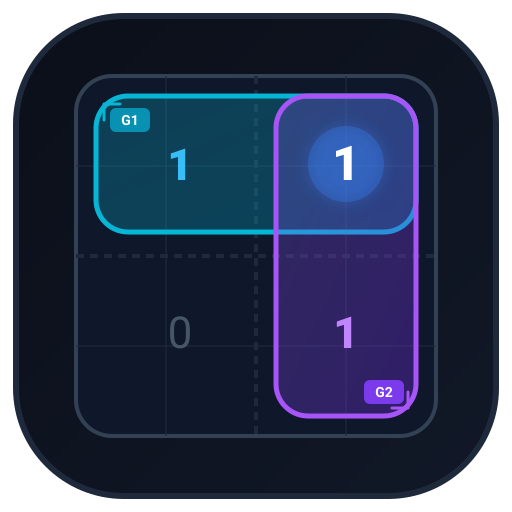

# Karnaugh Studio — Modern Karnaugh Map & Boolean Minimizer Desktop Application

<p align="center">
  
</p>

**Karnaugh Studio** is a modern, high-performance desktop application engineered for students, educators, and digital logic designers to visualize, learn, and simplify Boolean logic functions using Karnaugh maps (K-maps).

Built with **Rust** and **Tauri 2** with a restrained, modern frontend inspired by Linear and Raycast, the application pairs mathematical rigor (an exact Quine–McCluskey minimization engine with Petrick/branch-and-bound minimum-cost cover) with vector visual grouping and educational explanations.

---

## Features

- **Multi-Variable Support**:
  - **2-Variable Maps** ($2 \times 2$ grid, variables $A, B$)
  - **3-Variable Maps** ($2 \times 4$ grid, variables $A, B, C$)
  - **4-Variable Maps** ($4 \times 4$ grid, variables $A, B, C, D$)
- **Mathematically Sound Gray-Code Topology**:
  - Exact reflected binary Gray-code axis headers ($00, 01, 11, 10$).
  - Full toroidal adjacency support: horizontal edge wraparound, vertical edge wraparound, and 4-corner grouping ($m_0, m_2, m_8, m_{10} \implies B'D'$).
- **Interactive, Bi-Directional Truth Table**:
  - Full $2^n$ rows in standard binary order with MSB-first ordering.
  - Cycle outputs directly ($0 \to 1 \to X \to 0$) via mouse click or keyboard navigation (`0`, `1`, `X`, `Space`, `Enter`).
  - Batch actions: **All 0**, **All 1**, **Invert**.
  - Synchronous cell-by-cell update with the K-map grid.
- **Automatic Color-Coded Vector Overlays**:
  - Groups rendered using precise SVG vector overlays that scale and align seamlessly.
  - Proper handling of wraparounds: groups spanning opposite edges or corners are visualized as disjoint rounded boundaries with unified colors and $G_n$ badges, never crossing through unrelated middle cells.
  - Distinct accessible color palette (Cyan, Violet, Amber, Emerald, Rose, Blue, Teal, Fuchsia) optimized for both light and dark modes.
  - Overlays toggle to easily inspect raw cell values.
- **Dual Minimization (SoP & PoS)**:
  - **Sum of Products (SoP)**: Minimal product terms joined by OR ($F = A'B + BC'$).
  - **Product of Sums (PoS)**: Minimal sum terms joined by AND ($F = (A + B')(B + C)$).
  - Accurate algebraic handling of complements and maxterms.
  - Literals count and term count metrics.
  - One-click copy for plain-text algebraic expressions.
- **Educational Explanations & Insights**:
  - Contextual explanation for every group: explains why variables eliminated ($2^k$ cells eliminate $k$ variables via consensus identity $X + X' = 1$), toroidal boundary reasons, essential prime implicant justification, and don't-care effects.
  - Built-in educational guide modal explaining Karnaugh map axioms and rules.
- **Robust Edge Case Handling**:
  - Constant 0 ($F = 0$).
  - Constant 1 ($F = 1$).
  - All don't-care functions ($F = 0$, with clear indicator).
  - Pure deterministic tie-breaking.

---

## Technology Stack

- **Core Engine & Desktop Shell**: Rust (1.98+), Tauri 2
- **Frontend Framework**: React 19, TypeScript
- **Styling**: Tailwind CSS v4, Lucide Icons
- **Build Tooling**: Vite 8
- **Packaging**: Windows NSIS Installer (`.exe`), Windows MSI (`.msi`), and standalone Release Binary (`.exe`)

---

## Installation & Artifact Locations

### Generated Build Artifacts

The application has been compiled and packaged for Windows x64:

- **Windows NSIS Installer (`.exe`)**:
  ```
  src-tauri/target/release/bundle/nsis/Karnaugh Studio_1.0.0_x64-setup.exe
  ```
- **Windows MSI Installer (`.msi`)**:
  ```
  src-tauri/target/release/bundle/msi/Karnaugh Studio_1.0.0_x64_en-US.msi
  ```
- **Standalone Portable Executable (`.exe`)**:
  ```
  src-tauri/target/release/karnaugh-studio.exe
  ```

To install, simply execute `Karnaugh Studio_1.0.0_x64-setup.exe`. It configures desktop and start menu shortcuts with the custom application icon.

---

## Development & Building

### Prerequisites

- [Node.js](https://nodejs.org/) (v20+ recommended)
- [Rust](https://www.rust-lang.org/) (1.80+ recommended)
- Visual Studio C++ Build Tools (on Windows)

### Running in Development Mode

To start the Vite frontend development server alongside the Tauri desktop window:

```bash
# Install frontend dependencies
npm install

# Run Tauri desktop app in dev mode (hot reload enabled)
npm run tauri dev
```

### Running Automated Verification Tests

The Boolean minimization and K-map engine includes exhaustive verification tests:

```bash
cd src-tauri
cargo test
```

Test suite coverage (21 automated tests):
1. Exhaustive verification of all 16 possible 2-variable functions ($F_{SoP}$ and $F_{PoS}$ tested against every row with algebraic formula evaluation).
2. Exhaustive verification of all 256 possible 3-variable functions ($F_{SoP}$ and $F_{PoS}$ tested against every row with algebraic formula evaluation).
3. **Exhaustive verification of all 65,536 possible 4-variable functions** ($F_{SoP}$ and $F_{PoS}$ mathematically evaluated against all 16 minterm combinations).
4. **Independent brute-force combinatorial oracle** verifying that Quine-McCluskey finds the exact mathematical minimum terms and literals.
5. Toroidal Gray-code coordinate and 4-way adjacency verification.
6. Don't-care condition optimization tests.
7. Pure determinism consistency tests across repeated evaluations.
8. Safe confirmation workflows and unambiguous state preservation across variable switching.

### Building for Release

To produce production builds and Windows installers:

```bash
# Build frontend and compile release binary + NSIS installer
npm run tauri build
```

---

## Project Structure

```
├── .github/workflows/
│   └── build.yml               # CI/CD Windows packaging workflow
├── src/                        # React + TypeScript Frontend
│   ├── api.ts                  # Tauri IPC invoke bridge & web fallback
│   ├── App.css                 # Tailwind CSS styling & root themes
│   ├── App.tsx                 # Main layout & cross-component state
│   ├── main.tsx                # React entry point
│   ├── types/
│   │   └── kmap.ts             # TypeScript interfaces mirroring Rust models
│   ├── utils/
│   │   └── colors.ts           # Accessible group color palette
│   └── components/
│       ├── Header.tsx          # Titlebar, variable selector, theme toggle
│       ├── TruthTable.tsx      # Editable truth table with keyboard navigation
│       ├── KarnaughMap.tsx     # Gray-code grid & cell rendering
│       ├── GroupOverlay.tsx    # SVG vector group contours & badges
│       ├── ResultsPanel.tsx    # SoP/PoS tabs, expressions & explanations
│       └── EducationalModal.tsx# Educational student guide
├── src-tauri/                  # Rust Backend Engine
│   ├── Cargo.toml              # Rust crate manifest & dependencies
│   ├── tauri.conf.json         # Tauri 2 configuration & bundle metadata
│   ├── icons/                  # Generated Windows icons (.ico, .png, .icns)
│   └── src/
│       ├── main.rs             # Desktop executable entry
│       ├── lib.rs              # Tauri plugin setup & command dispatch
│       ├── commands.rs         # Tauri IPC commands (solve_kmap, etc.)
│       ├── models.rs           # Shared serializable data models
│       ├── truth_table.rs      # Truth table generation & term extraction
│       ├── kmap.rs             # Gray code ordering & rect mapping
│       ├── minimizer.rs        # Quine-McCluskey & exact minimum cover
│       ├── expression.rs       # SoP/PoS formatting & pedagogical explanations
│       └── verification_tests.rs# Exhaustive unit & mathematical tests
├── app-icon.svg                # Master application logo
└── package.json                # NPM configuration & build scripts
```

---

## License

MIT License. Designed and engineered for modern computer engineering education.
